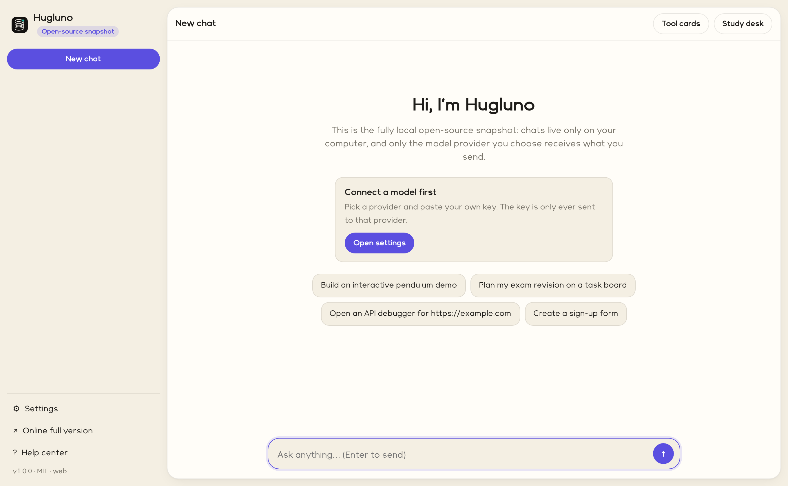

> ### 🌐 Want account sync, cloud runs, smart routing and a subscription service? → **[Hugluno online subscription full version: hugluno.c0curic.top](https://hugluno.c0curic.top)**
> This is its **open-source snapshot**: fully local, no account, no subscription, no proxy — all code public, audit it freely.

[简体中文](README.md) · **English** · [Français](README.fr.md)

📘 **[Full deployment guide](docs/DEPLOY.en.md)** (Windows / Mac install · local run · website deployment · system security prompts · security policy · demos) · [Copyright & license](COPYRIGHT.md) · [Security policy](SECURITY.md)

# Hugluno Open-Source Snapshot

Chat with your own model key and let it build **interactive tool cards** and **study-desk** demos on the spot. Everything stays on your computer: chats are stored locally and only the model provider you choose receives what you send.

- Core features = the basic part of the full version's **Luno I**, **with every online feature removed**
- 📦 Three ways to get it: **Windows installer (.exe)** · **Mac installer (.dmg)** · **website bundle (.zip) for your own site**
- 🖥 **Designed for desktop only** (Windows / Mac / desktop browsers); phones and tablets see a notice page
- 🔤 The UI uses only our own typeface **MaxRIous** (with MaxCN for Chinese); 🌍 UI in 中文 / English / Français
- 🔍 **All code is here**, plus an automatic audit script: `node tools/audit.mjs`
- ©️ **Noncommercial use only** (PolyForm Noncommercial 1.0.0), © 2026 C0curic Studio — see [COPYRIGHT.md](COPYRIGHT.md)

<p align="center"></p>

## What is in and what is out

| | Snapshot (this repo) | Online full version |
|---|---|---|
| Chat (streaming, Markdown, code highlighting, formulas) | ✅ | ✅ |
| **5 basic tool cards**: API debugger · task board · video editor · code diff · dynamic form | ✅ | ✅ |
| **Study desk** (learning window: interactive demos written by the model, fully offline sandbox) | ✅ | ✅ |
| **Lunosland** floating island (desktop app) | ✅ | ✅ |
| 3-language UI, light/dark | ✅ | ✅ |
| Help-center links (opened only when you click) | ✅ | ✅ |
| Account login · multi-device sync · cloud runs | ❌ none | ✅ |
| Subscription page · plans · redeem codes | ❌ none | ✅ |
| Model-request proxy / smart routing / answer cache | ❌ none (direct to the URL you enter) | ✅ |
| **Local Agent** (desktop, lite: one model, one chat loop, no workflows): reads/writes files only in the folder you choose, optional commands (each one confirmed) | ✅ | ✅ (full version adds workflows and cloud runs) |
| Research desk (science sandbox) · computer control · live co-pilot | ❌ none | ✅ |
| Auto-update · usage analytics | ❌ none (and never will be) | — |

## Privacy: verifiable facts, not promises

1. **No backend.** There is no server code here and no "our server" to connect to.
2. **Only two kinds of requests leave your computer:** ① chat requests to **the model URL you enter**; ② when you press **Send** in the API debugger card, a request to the address you typed — and the app **asks you every time**. (Opt-in exception: the desktop Local Agent's "run commands" is off by default; when on, every command is confirmed and runs in your system shell, whose own network access does not pass through the gate below.)
3. **The desktop app has a gate:** the main process blocks every request not on the allow-list (`desktop/policy.js`, unit-tested); Settings shows a "network log".
4. **Your key:** OS keychain on desktop; browser storage on web (optional passphrase encryption). **It is never sent anywhere except the provider you chose.**
5. **Code the model writes in the study desk** runs in an opaque-origin sandbox with `connect-src 'none'` — it cannot reach the network even if it tries.
6. **One-click erase** of all local data; export / import chats (keys excluded).

Check it yourself: `node tools/audit.mjs` (under a second) verifies: no unplanned `fetch`/WebSocket, no external resources, only our own fonts, no account/subscription/proxy/science-sandbox/computer-control code, no secrets. CI runs it on every commit.

## Usage (full steps in the [deployment guide](docs/DEPLOY.en.md))

**A. Desktop installer** — download `Hugluno-Snapshot-Setup-x.y.z.exe` (Windows 10+) or `Hugluno-Snapshot-x.y.z-universal.dmg` (macOS 11+) from [Releases](https://github.com/C0curicStudio/Hugluno/releases), verify the SHA-256, then install.
Your system will show an "unknown publisher / developer cannot be verified" prompt because the installer is not commercially code-signed. **We explain why, with pictures, every step and how to cancel, in the [deployment guide](docs/DEPLOY.en.md#system-security-prompts)**; if unsure, cancel and use B or C, or visit the [help center](https://support.c0curic.top/max/settings/install-safety).

**B. Local web (needs Node.js 18+)**



**C. Deploy to your own website**


First run: Settings → pick a provider → paste your key → Test connection → choose a model → Save.

## Layout

```
app/       web app (no build step, deploy as-is)  index.html · js/ · css/ · fonts/ · vendor/ · lab.html
desktop/   Electron shell (main.js gate · policy.js · preload.js · Lunosland)
tools/     serve.mjs local server · audit.mjs audit · pack-web.mjs bundle · lock-csp.mjs tighten CSP
deploy/    nginx · Caddy · _headers · Dockerfile
docs/      deployment guides (3 languages) · screenshots · demos
tests/     unit tests · end-to-end tests · desktop smoke test
```

## Security, feedback, license

- Security policy and vulnerability reports: [SECURITY.md](SECURITY.md) · unsure? Read the [help center: Snapshot](https://support.c0curic.top/max/snapshot) or open an Issue.
- **Copyright & license:** © 2026 C0curic Studio. The code is published under the [PolyForm Noncommercial License 1.0.0](LICENSE) — **the source is readable, auditable and modifiable, but for noncommercial use only** (a source-available license, not an OSI open-source license). Commercial use needs prior written permission. Details: [COPYRIGHT.md](COPYRIGHT.md). Fonts: [app/fonts/FONTS.md](app/fonts/FONTS.md). Third-party: [THIRD_PARTY_LICENSES.md](THIRD_PARTY_LICENSES.md).
- Develop: `npm test` (unit) · `npm run e2e` (real browser) · `npm run desktop` (desktop app, run `npm i` first).

[C0curic Studio](https://c0curic.top) · [Help center](https://support.c0curic.top) · [Online full version](https://hugluno.c0curic.top)
