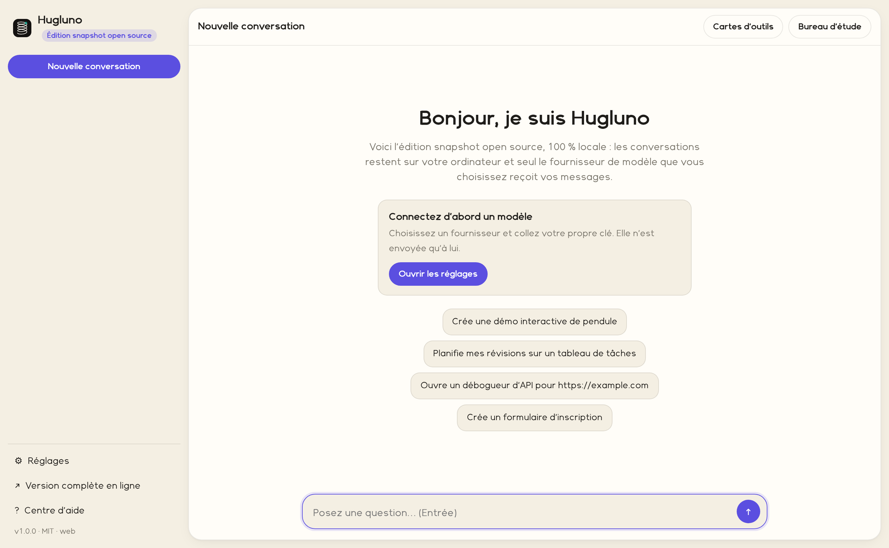

> ### 🌐 Besoin de synchronisation de compte, d’exécution cloud, de routage intelligent et d’un abonnement ? → **[Hugluno, version complète en ligne par abonnement : hugluno.c0curic.top](https://hugluno.c0curic.top)**
> Ici, c’est son **édition snapshot open source** : 100 % locale, sans compte, sans abonnement, sans proxy — tout le code est public, auditez-le librement.

[简体中文](README.md) · [English](README.en.md) · **Français**

# Hugluno — édition snapshot open source

Discutez avec votre propre clé de modèle et laissez-le fabriquer sur le moment des **cartes d’outils interactives** et des démos dans le **bureau d’étude**. Tout reste sur votre ordinateur : les conversations sont stockées en local et seul le fournisseur de modèle que vous choisissez reçoit ce que vous envoyez.

- Fonctions de base = la partie de base de **Luno I** de la version complète, **sans aucune fonction en ligne**
- 📦 Trois façons de l’obtenir : **installateur Windows (.exe)** · **installateur Mac (.dmg)** · **paquet web (.zip) pour votre propre site**
- 🖥 **Conçu pour ordinateur uniquement** (Windows / Mac / navigateurs de bureau) ; téléphones et tablettes voient une page d’information
- 🔤 L’interface n’utilise que notre propre police **MaxRIous** (avec MaxCN pour le chinois) ; 🌍 interface en 中文 / English / Français
- 🔍 **Tout le code est ici**, avec un script d’audit automatique : `node tools/audit.mjs`
- ©️ **Usage non commercial uniquement** (PolyForm Noncommercial 1.0.0), © 2026 C0curic Studio — voir [COPYRIGHT.md](COPYRIGHT.md)

<p align="center"></p>

## Ce qui est inclus et ce qui ne l’est pas

| | Snapshot (ce dépôt) | Version complète en ligne |
|---|---|---|
| Discussion (flux, Markdown, coloration du code, formules) | ✅ | ✅ |
| **5 cartes d’outils de base** : débogueur d’API · tableau de tâches · montage vidéo · comparaison de code · formulaire dynamique | ✅ | ✅ |
| **Bureau d’étude** (fenêtre d’étude : démos interactives écrites par le modèle, bac à sable totalement hors ligne) | ✅ | ✅ |
| Île flottante **Lunosland** (application de bureau) | ✅ | ✅ |
| Interface en 3 langues, clair / sombre | ✅ | ✅ |
| Liens vers le centre d’aide (ouverts seulement si vous cliquez) | ✅ | ✅ |
| Connexion à un compte · synchronisation multi-appareils · exécution cloud | ❌ aucune | ✅ |
| Page d’abonnement · formules · codes d’échange | ❌ aucune | ✅ |
| Proxy de requêtes / routage intelligent / cache de réponses | ❌ aucun (direct vers l’URL saisie) | ✅ |
| Agent · bureau de recherche (bac à sable scientifique) · prise de contrôle · copilote en direct | ❌ aucun | ✅ |
| Mise à jour automatique · statistiques d’usage | ❌ aucune (et il n’y en aura jamais) | — |

## Confidentialité : des faits vérifiables, pas des promesses

1. **Aucun serveur.** Pas de code serveur ici, pas de « nos serveurs » auxquels se connecter.
2. **Seuls deux types de requêtes quittent votre ordinateur :** ① les requêtes de discussion vers **l’URL de modèle que vous saisissez** ; ② quand vous appuyez sur **Envoyer** dans la carte débogueur d’API, une requête vers l’adresse tapée — et l’application **vous demande à chaque fois**.
3. **L’application de bureau a un portail :** le processus principal bloque toute requête hors liste blanche (`desktop/policy.js`, testé) ; les Réglages affichent un « journal réseau ».
4. **Votre clé :** trousseau du système sur bureau ; stockage du navigateur sur le web (chiffrement par phrase secrète en option). **Elle n’est jamais envoyée ailleurs que chez le fournisseur choisi.**
5. **Le code écrit par le modèle dans le bureau d’étude** s’exécute dans un bac à sable à origine opaque avec `connect-src 'none'` — impossible d’accéder au réseau.
6. **Effacement en un clic** de toutes les données locales ; export / import des conversations (clés exclues).

Vérifiez vous-même : `node tools/audit.mjs` (moins d’une seconde) contrôle : aucun `fetch`/WebSocket imprévu, aucune ressource externe, uniquement nos polices, aucun code de compte/abonnement/proxy/bac à sable scientifique/prise de contrôle, aucun secret. La CI l’exécute à chaque commit.

## Utilisation (étapes complètes dans le [guide de déploiement](docs/DEPLOY.fr.md))

**A. Installateur de bureau** — téléchargez `Hugluno-Snapshot-Setup-x.y.z.exe` (Windows 10+) ou `Hugluno-Snapshot-x.y.z-universal.dmg` (macOS 11+) depuis [Releases](https://github.com/C0curicStudio/Hugluno/releases), vérifiez le SHA-256, puis installez.
Votre système affichera une alerte « éditeur inconnu / développeur non vérifié », car l’installateur n’a pas de signature de code commerciale. **Nous expliquons pourquoi, avec images, chaque étape et comment annuler, dans le [guide de déploiement](docs/DEPLOY.fr.md#alertes-de-sécurité-du-système)** ; en cas de doute, annulez et utilisez B ou C, ou consultez le [centre d’aide](https://support.c0curic.top/max/settings/install-safety).

**B. Web local (Node.js 18+ requis)**



**C. Déployer sur votre propre site**


Premier lancement : Réglages → choisir un fournisseur → coller la clé → Tester la connexion → choisir un modèle → Enregistrer.

## Arborescence

```
app/       application web (sans build, à déployer telle quelle)  index.html · js/ · css/ · fonts/ · vendor/ · lab.html
desktop/   coque Electron (portail main.js · policy.js · preload.js · Lunosland)
tools/     serve.mjs serveur local · audit.mjs audit · pack-web.mjs paquet · lock-csp.mjs resserrer la CSP
deploy/    nginx · Caddy · _headers · Dockerfile
docs/      guides de déploiement (3 langues) · captures · démos
tests/     tests unitaires · tests de bout en bout · test de fumée desktop
```

## Sécurité, retours, licence

- Politique de sécurité et signalement de vulnérabilités : [SECURITY.md](SECURITY.md) · un doute ? Lisez le [centre d’aide : Snapshot](https://support.c0curic.top/max/snapshot) ou ouvrez une Issue.
- **Droits d’auteur et licence :** © 2026 C0curic Studio. Le code est publié sous la [PolyForm Noncommercial License 1.0.0](LICENSE) — **le code source est lisible, auditable et modifiable, mais réservé à un usage non commercial** (licence à code source disponible, pas une licence open source OSI). L’usage commercial exige une autorisation écrite préalable. Détails : [COPYRIGHT.md](COPYRIGHT.md). Polices : [app/fonts/FONTS.md](app/fonts/FONTS.md). Tiers : [THIRD_PARTY_LICENSES.md](THIRD_PARTY_LICENSES.md).
- Développer : `npm test` (unitaires) · `npm run e2e` (vrai navigateur) · `npm run desktop` (application de bureau, `npm i` d’abord).

[C0curic Studio](https://c0curic.top) · [Centre d’aide](https://support.c0curic.top) · [Version complète en ligne](https://hugluno.c0curic.top)
