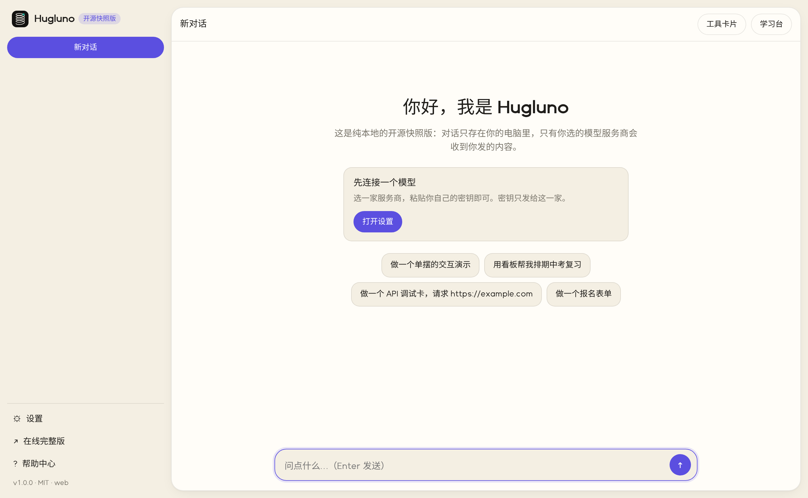

> ### 🌐 想要账号同步、云端运行、智能路由、订阅服务？→ **[Hugluno 在线订阅服务完整版：hugluno.c0curic.top](https://hugluno.c0curic.top)**
> 这里是它的**开源快照版**：纯本地、无账号、无订阅、无代理，代码全部公开，随便审查。

**简体中文** · [English](README.en.md) · [Français](README.fr.md)

# Hugluno 开源快照版（GitHub Open-Source Snapshot）

用你自己的模型密钥聊天，让它现场做出**可操作的工具卡片**和**学习台**里的交互演示。一切都在你的电脑上：对话存在本机，只有你选的模型服务商会收到你发的内容。

- 基础功能 = 完整版 **Luno I** 的基础部分，**去掉全部在线功能**
- 📦 三种拿法：**Windows 安装包（.exe）** · **Mac 安装包（.dmg）** · **网站部署包（.zip，放到自己的网站）**
- 🖥 **只为电脑端设计和适配**（Windows / Mac / 桌面浏览器）；手机和平板会看到提示页
- 🔤 界面只用我们自有的字体 **MaxRIous**（中文搭配 MaxCN）；🌍 中文 / English / Français 三语界面
- 🔍 **所有代码都在这里**，附自动审查脚本 `node tools/audit.mjs`

<p align="center"></p>

## 有什么、没有什么

| | 快照版（本仓库） | 在线完整版 |
|---|---|---|
| 对话（流式、Markdown、代码高亮、公式） | ✅ | ✅ |
| **5 张基础工具卡**：接口调试 · 任务看板 · 视频剪辑 · 代码比对 · 动态表单 | ✅ | ✅ |
| **学习台**（学习窗口：模型现写的交互演示，完全离线沙盒） | ✅ | ✅ |
| **Lunosland** 悬浮岛（桌面版） | ✅ | ✅ |
| 三语界面、深浅色 | ✅ | ✅ |
| 帮助中心链接（点了才打开） | ✅ | ✅ |
| 账号登录 · 多设备同步 · 云端运行 | ❌ 没有 | ✅ |
| 订阅页 · 订阅档 · 兑换码 | ❌ 没有 | ✅ |
| 模型请求代理 / 智能路由 / 回答缓存 | ❌ 没有（直连你填的接口） | ✅ |
| Agent · 研究台（科研沙盒）· 操作接管 · 实时协助 | ❌ 没有 | ✅ |
| 自动更新 · 使用统计 | ❌ 没有（也不会有） | — |

## 隐私：不是承诺，是可以检查的事实

1. **没有后端。** 这里没有服务器代码，也没有任何「我们的服务器」要连。
2. **只有两种请求会离开你的电脑：** ① 对话时发给**你填的模型接口**；② 你在「接口调试」卡点**发送**时，请求你填的地址——而且**每次先弹窗问你**。
3. **桌面版有总闸：** 主进程拦截所有不在白名单里的请求（`desktop/policy.js`，有单元测试）；设置里能看到「网络记录」。
4. **密钥**：桌面版存系统钥匙串；网页版存浏览器本地（可选口令加密）。**绝不发给除你选的服务商以外的任何地址。**
5. **学习台里模型写的代码**跑在不透明来源的沙盒里，`connect-src 'none'`——想联网也联不了。
6. **一键清除**本机全部数据；可导出 / 导入对话（不含密钥）。

自己检查：`node tools/audit.mjs`（不到一秒）会逐条验证：没有计划外的 `fetch`/WebSocket、没有外部资源、字体只有自有字体、没有账号/订阅/代理/科研沙盒/操作接管代码、没有密钥。每次提交 CI 都会跑。

## 怎么用（详细流程见 [部署教程](docs/DEPLOY.zh.md)）

**A. 桌面安装包** — 到 [Releases](https://github.com/C0curicStudio/Hugluno/releases) 下载 `Hugluno-Snapshot-Setup-x.y.z.exe`（Windows 10+）或 `Hugluno-Snapshot-x.y.z-universal.dmg`（macOS 11+），核对 SHA-256 后安装。
系统会弹出「未知发布者 / 无法验证开发者」之类的提示——因为安装包没有商业代码签名。**我们把原因、图示、每一步和取消办法都写在 [部署教程](docs/DEPLOY.zh.md#系统安全提示) 里**；不放心就点取消，改用 B 或 C，或去 [帮助中心](https://support.c0curic.top/max/settings/install-safety)。

**B. 本地网页（要 Node.js 18+）**


**C. 部署到你自己的网站**


首次使用：设置 → 选服务商 → 粘贴密钥 → 测试连接 → 选模型 → 保存。

## 目录

```
app/       网页应用（无需构建，原样部署）  index.html · js/ · css/ · fonts/ · vendor/ · lab.html
desktop/   Electron 桌面外壳（main.js 总闸 · policy.js · preload.js · Lunosland）
tools/     serve.mjs 本地服务 · audit.mjs 审查 · pack-web.mjs 打包 · lock-csp.mjs 收紧 CSP
deploy/    nginx · Caddy · _headers · Dockerfile
docs/      部署教程（三语）· 截图 · 演示
tests/     单元测试 · 端到端测试 · 桌面冒烟测试
```

## 安全、反馈、许可

- 安全策略与漏洞报告：[SECURITY.md](SECURITY.md)　· 拿不准？看 [帮助中心：快照版](https://support.c0curic.top/max/snapshot) 或提 Issue。
- 代码：[MIT](LICENSE)。字体：见 [app/fonts/FONTS.md](app/fonts/FONTS.md)。第三方：[THIRD_PARTY_LICENSES.md](THIRD_PARTY_LICENSES.md)。
- 开发：`npm test`（单元）· `npm run e2e`（真浏览器）· `npm run desktop`（桌面版，需 `npm i`）。

[C0curic Studio](https://c0curic.top) · [帮助中心](https://support.c0curic.top) · [在线完整版](https://hugluno.c0curic.top)
