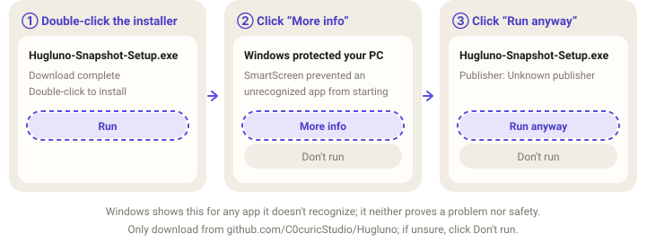
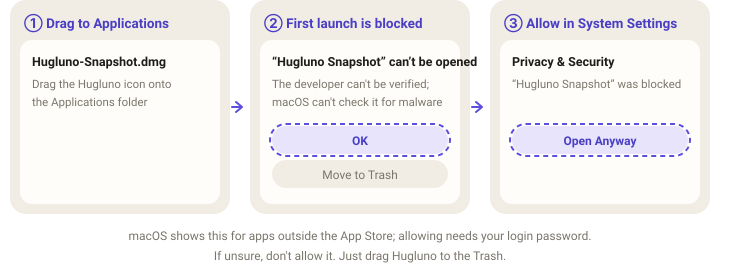

# Deployment guide (English)

[简体中文](DEPLOY.zh.md) · [Français](DEPLOY.fr.md) · [Back to README](../README.en.md)

> Online subscription full version: <https://hugluno.c0curic.top> · Help center: <https://support.c0curic.top/max/snapshot-deploy>
> **If unsure, don't install.** At any step you are uneasy about, stop, use "Option 3: local web" or the online full version, or ask us in the help center / an Issue.

## Pick an option

| Option | Best for | Needs | System prompt |
|---|---|---|---|
| ① Windows installer `.exe` | Windows 10/11 PCs | nothing | Yes (SmartScreen) — see [below](#system-security-prompts) |
| ② Mac installer `.dmg` | macOS 11+ (Intel / Apple silicon) | nothing | Yes (Gatekeeper) — see [below](#system-security-prompts) |
| ③ Local web | Trying it first, no install | Node.js 18+ | None |
| ④ Deploy to a website | Your own server / static host, open from any desktop browser | a domain or hosting | None |

Desktop only; phones and tablets show "Please open this on a computer".

## For every option first: verify the file was not swapped

Every Release file has a SHA-256 (`SHA256SUMS.txt`) and a GitHub build attestation.

```bash
# Windows PowerShell
Get-FileHash .\Hugluno-Snapshot-Setup-1.2.0.exe -Algorithm SHA256
# macOS / Linux
shasum -a 256 Hugluno-Snapshot-1.2.0-universal.dmg
# Optional: prove it was built by this repo's Actions
gh attestation verify Hugluno-Snapshot-Setup-1.2.0.exe --repo C0curicStudio/Hugluno
```
If the value **does not match** `SHA256SUMS.txt`, do not install: delete it, download again, or open an Issue.

## Option 1: Windows installer

1. Open <https://github.com/C0curicStudio/Hugluno/releases> and download `Hugluno-Snapshot-Setup-x.y.z.exe` (only from here).
2. Verify the SHA-256 as above.
3. Double-click → "Windows protected your PC" appears (pictured below) → you may **continue** or **cancel**.
4. Installer wizard (中 / EN / FR): choose a folder → finish. **No administrator rights needed** (per-user install).
5. Open "Hugluno Snapshot" and enter base URL, key and model in Settings.

Everything the installer does: copies program files to the folder you pick (default `%LOCALAPPDATA%\Programs\Hugluno Snapshot`), creates Start-menu and desktop shortcuts, writes an uninstall entry. **No service, no autostart, no system-setting changes, no network.**
Data: `%APPDATA%\Hugluno Snapshot` (chats, window settings); the key is encrypted by Windows Data Protection (DPAPI).
Uninstall: Settings → Apps → Hugluno Snapshot → Uninstall; to remove data also delete the folder above (or first use "Settings → Erase all data on this device").

## Option 2: Mac installer

1. Download `Hugluno-Snapshot-x.y.z-universal.dmg` and check it with `shasum -a 256`.
2. Open the dmg and drag the icon into Applications.
3. The first launch is blocked (pictured below): open "System Settings → Privacy & Security", next to "Hugluno Snapshot was blocked" click **Open Anyway**, and enter your login password.
4. Still blocked: in Terminal run `xattr -dr com.apple.quarantine "/Applications/Hugluno Snapshot.app"` (it only removes the download quarantine flag), then open it.
5. Data: `~/Library/Application Support/Hugluno Snapshot`; the key lives in the Keychain.
Uninstall: drag the app to the Trash; delete the folder above to remove data.

## System security prompts

**Why they appear:** Windows SmartScreen and macOS Gatekeeper block software with no commercial developer signature and few downloads. The snapshot is open source and its installers are **not commercially code-signed** (Windows) and **not notarized by Apple** (Mac), so the system will always warn. **The warning does not mean something is wrong, and it does not guarantee safety** — judge with the SHA-256 and the source code.

### Windows: "Windows protected your PC"


Continue: "More info" → "Run anyway". **Cancel: click "Don't run"** — nothing is installed.

### macOS: "cannot be opened because the developer cannot be verified"


Continue: System Settings → Privacy & Security → Open Anyway. **Cancel: click OK or "Move to Trash".**

### Our security policy (read before installing)
- Installers are built only by this repository's GitHub Actions and published only in Releases, with SHA-256 and attestation; **do not use installers from any other site, chat group or file share.**
- The app has **no account, no auto-update and no analytics**, and does not go online in the background. To upgrade, download the new version yourself and verify it.
- Desktop app: windows run sandboxed, the page has no Node / file-system access; permission requests (camera, microphone, location…) are always denied; every network request passes a gate that only allows the model URL you entered.
- We will **never** ask you to disable antivirus, grant admin rights, or paste unexplained terminal commands (the `xattr` line only removes the quarantine flag; you can skip it and use Option 3).
- Uneasy at any step: **cancel**, and use Option 3 / the online full version; or read the help-center page [Security prompts when installing](https://support.c0curic.top/max/settings/install-safety); still unsure — open an Issue and we will explain.
- Found a vulnerability: see [SECURITY.md](../SECURITY.md).

## Option 3: local web (simplest, easiest to audit)



```bash
git clone https://github.com/C0curicStudio/Hugluno.git && cd Hugluno
node tools/audit.mjs        # optional: audit first
node tools/serve.mjs        # → http://127.0.0.1:8080/
```
`serve.mjs` has no dependencies, is read-only and listens on `127.0.0.1` by default. Use `--port 9000` to change the port. Data lives in that browser; another browser starts fresh.

## Option 4: deploy to your own website



### 1. Get the website bundle
- Download `hugluno-snapshot-web-x.y.z.zip` from Releases and unzip to `hugluno-snapshot-web/`; or
- build it: `node tools/pack-web.mjs` (outputs `dist/…zip` and its SHA-256; the same source always yields a byte-identical zip, so you can reproduce and compare).

### 2. (Recommended) tighten the CSP to your model API only
```bash
node tools/lock-csp.mjs --api https://api.deepseek.com --out dist/site
```
Browsers will then refuse any request from the page to any other address. (Skip this if you want the API debugger to reach other hosts; for Ollama on your LAN add `--api http://192.168.1.20:11434`.)

### 3. Choose where to host
| Host | How |
|---|---|
| **Cloudflare Pages / Netlify** | In the dashboard upload the folder `hugluno-snapshot-web` (or `dist/site`); put `deploy/_headers` at its root. |
| **GitHub Pages** | Settings → Pages → Source: *GitHub Actions*; run *Deploy web to GitHub Pages* from the Actions tab. |
| **Your own server (nginx)** | Unzip to `/var/www/hugluno`, use `deploy/nginx.conf` (edit domain and certificate paths), `nginx -t && systemctl reload nginx`. |
| **Caddy** (automatic https) | Unzip to `/srv/hugluno`, use `deploy/Caddyfile` (edit the domain), `caddy run`. |
| **Docker** | `docker build -f deploy/Dockerfile -t hugluno-snapshot .` → `docker run --rm -p 127.0.0.1:8080:8080 hugluno-snapshot` |

### 4. Go-live checklist
- [ ] Served over **https** (or localhost);
- [ ] Response headers include `X-Content-Type-Options` and `Referrer-Policy: no-referrer` (already in `deploy/`);
- [ ] `/fonts/*` sends `Access-Control-Allow-Origin: *` (the study desk uses our own font);
- [ ] For personal use only: add HTTP basic auth (two commented lines in `deploy/nginx.conf`);
- [ ] **Put no secrets on the server**: the site has no backend; each visitor enters their key in their own browser.

### Good to know for the web edition
- Keys are stored in the visitor's browser localStorage (optionally passphrase-encrypted in Settings); a different browser must re-enter them.
- Calling a model API straight from the browser requires the provider to allow CORS. If you see "CORS", use the desktop app — its main process makes the request and has no such limit.
- Local Ollama: set `OLLAMA_ORIGINS=*` (or your site's address) before starting it.

## Upgrade and roll back
Download the new version → verify the SHA-256 → install over the old one (Windows / Mac) or replace the website files. Chats are kept (they live in the user-data folder / the browser). To roll back, install the older version.

## FAQ
- **Won't open / blocked?** See "System security prompts" above; otherwise use Option 3.
- **"Test connection" fails?** Check the base URL (some end in `/v1`, others differ), that the key has credit, and, on web, whether CORS blocks it.
- **Want to confirm it never goes online secretly?** Settings → Network log; or `node tools/audit.mjs`; or check with your firewall / a packet capture.
- **Want account sync or cloud runs?** Those belong to the [online full version](https://hugluno.c0curic.top); the snapshot does not include them.
