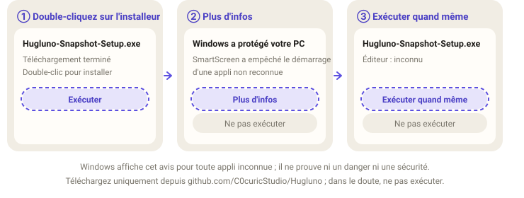
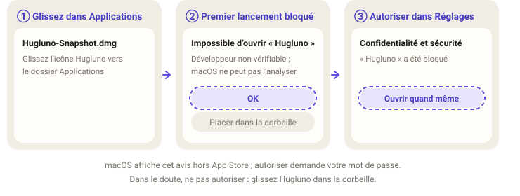

# Guide de déploiement (Français)

[简体中文](DEPLOY.zh.md) · [English](DEPLOY.en.md) · [Retour au README](../README.fr.md)

> Version complète en ligne par abonnement : <https://hugluno.c0curic.top> · Centre d’aide : <https://support.c0curic.top/max/snapshot-deploy>
> **En cas de doute, n’installez pas.** À n’importe quelle étape, arrêtez-vous, utilisez l’« Option 3 : web local » ou la version complète en ligne, ou posez-nous la question (centre d’aide / Issue).

## Choisir une option

| Option | Pour qui | Nécessite | Alerte système |
|---|---|---|---|
| ① Installateur Windows `.exe` | PC Windows 10/11 | rien | Oui (SmartScreen) — voir [ci-dessous](#alertes-de-sécurité-du-système) |
| ② Installateur Mac `.dmg` | macOS 11+ (Intel / Apple silicon) | rien | Oui (Gatekeeper) — voir [ci-dessous](#alertes-de-sécurité-du-système) |
| ③ Web local | Essayer sans installer | Node.js 18+ | Aucune |
| ④ Déployer sur un site | Votre serveur / hébergeur statique, ouvert depuis n’importe quel navigateur de bureau | un domaine ou un hébergement | Aucune |

Ordinateur uniquement ; téléphones et tablettes affichent « Veuillez ouvrir ceci sur un ordinateur ».

## Pour toutes les options, d’abord : vérifier que le fichier n’a pas été remplacé

Chaque fichier de Release a un SHA-256 (`SHA256SUMS.txt`) et une attestation de build GitHub.

```bash
# Windows PowerShell
Get-FileHash .\Hugluno-Snapshot-Setup-1.0.0.exe -Algorithm SHA256
# macOS / Linux
shasum -a 256 Hugluno-Snapshot-1.0.0-universal.dmg
# Facultatif : prouver qu’il a été construit par les Actions de ce dépôt
gh attestation verify Hugluno-Snapshot-Setup-1.0.0.exe --repo C0curicStudio/Hugluno
```
Si la valeur **ne correspond pas** à `SHA256SUMS.txt`, n’installez pas : supprimez, retéléchargez ou ouvrez une Issue.

## Option 1 : installateur Windows

1. Ouvrez <https://github.com/C0curicStudio/Hugluno/releases> et téléchargez `Hugluno-Snapshot-Setup-x.y.z.exe` (uniquement ici).
2. Vérifiez le SHA-256 comme ci-dessus.
3. Double-clic → « Windows a protégé votre ordinateur » (image ci-dessous) → vous pouvez **continuer** ou **annuler**.
4. Assistant (中 / EN / FR) : choisissez un dossier → terminer. **Aucun droit administrateur requis** (installation par utilisateur).
5. Ouvrez « Hugluno Snapshot » et saisissez URL, clé et modèle dans Réglages.

Tout ce que fait l’installateur : copie les fichiers dans le dossier choisi (par défaut `%LOCALAPPDATA%\Programs\Hugluno Snapshot`), crée les raccourcis menu Démarrer et bureau, écrit une entrée de désinstallation. **Aucun service, aucun démarrage automatique, aucun changement de paramètres système, aucun réseau.**
Données : `%APPDATA%\Hugluno Snapshot` (conversations, réglages de fenêtre) ; la clé est chiffrée par la protection des données Windows (DPAPI).
Désinstaller : Paramètres → Applications → Hugluno Snapshot → Désinstaller ; pour supprimer aussi les données, effacez le dossier ci-dessus (ou d’abord « Réglages → Effacer toutes les données de cet appareil »).

## Option 2 : installateur Mac

1. Téléchargez `Hugluno-Snapshot-x.y.z-universal.dmg` et vérifiez-le avec `shasum -a 256`.
2. Ouvrez le dmg et glissez l’icône dans Applications.
3. Le premier lancement est bloqué (image ci-dessous) : ouvrez « Réglages Système → Confidentialité et sécurité », à côté de « Hugluno Snapshot a été bloqué » cliquez sur **Ouvrir quand même** et saisissez votre mot de passe.
4. Toujours bloqué : dans le Terminal, `xattr -dr com.apple.quarantine "/Applications/Hugluno Snapshot.app"` (cela retire seulement le marqueur de quarantaine), puis ouvrez.
5. Données : `~/Library/Application Support/Hugluno Snapshot` ; la clé est dans le Trousseau.
Désinstaller : glissez l’app dans la corbeille ; supprimez le dossier ci-dessus pour les données.

## Alertes de sécurité du système

**Pourquoi elles apparaissent :** SmartScreen (Windows) et Gatekeeper (macOS) bloquent les logiciels sans signature de développeur commerciale et peu téléchargés. Le snapshot est open source ; ses installateurs **n’ont pas de signature de code commerciale** (Windows) et **ne sont pas notarisés par Apple** (Mac) : le système avertira donc toujours. **L’alerte ne signifie pas qu’il y a un problème, et ne garantit pas la sécurité** — jugez avec le SHA-256 et le code source.

### Windows : « Windows a protégé votre ordinateur »


Continuer : « Informations complémentaires » → « Exécuter quand même ». **Annuler : « Ne pas exécuter »** — rien n’est installé.

### macOS : « ne peut pas être ouvert car le développeur ne peut pas être vérifié »


Continuer : Réglages Système → Confidentialité et sécurité → Ouvrir quand même. **Annuler : OK ou « Placer dans la corbeille ».**

### Notre politique de sécurité (à lire avant d’installer)
- Les installateurs sont construits uniquement par les GitHub Actions de ce dépôt et publiés uniquement dans Releases, avec SHA-256 et attestation ; **n’utilisez pas d’installateur venant d’un autre site, groupe de discussion ou partage de fichiers.**
- L’application n’a **aucun compte, aucune mise à jour automatique, aucune statistique** et ne se connecte pas en arrière-plan. Pour mettre à jour, téléchargez vous-même la nouvelle version et vérifiez-la.
- Application de bureau : fenêtres en bac à sable, la page n’a aucun accès à Node ni au système de fichiers ; les demandes d’autorisation (caméra, micro, localisation…) sont toujours refusées ; toute requête réseau passe par un portail qui n’autorise que l’URL de modèle saisie.
- Nous ne vous demanderons **jamais** de désactiver l’antivirus, d’accorder des droits administrateur ou de coller des commandes inexpliquées (la ligne `xattr` retire seulement la quarantaine ; vous pouvez l’ignorer et utiliser l’Option 3).
- Un doute à n’importe quelle étape : **annulez** et utilisez l’Option 3 / la version complète en ligne ; ou lisez la page du centre d’aide [Alertes de sécurité à l’installation](https://support.c0curic.top/max/settings/install-safety) ; toujours un doute — ouvrez une Issue, nous expliquerons.
- Vulnérabilité trouvée : voir [SECURITY.md](../SECURITY.md).

## Option 3 : web local (le plus simple, le plus facile à auditer)



```bash
git clone https://github.com/C0curicStudio/Hugluno.git && cd Hugluno
node tools/audit.mjs        # facultatif : auditer d’abord
node tools/serve.mjs        # → http://127.0.0.1:8080/
```
`serve.mjs` n’a aucune dépendance, est en lecture seule et n’écoute que `127.0.0.1` par défaut. `--port 9000` change le port. Les données restent dans ce navigateur ; un autre navigateur repart de zéro.

## Option 4 : déployer sur votre propre site


### 1. Obtenir le paquet web
- Téléchargez `hugluno-snapshot-web-x.y.z.zip` depuis Releases et décompressez en `hugluno-snapshot-web/` ; ou
- construisez-le : `node tools/pack-web.mjs` (produit `dist/…zip` et son SHA-256 ; une même source donne toujours un zip identique octet pour octet, vous pouvez reproduire et comparer).

### 2. (Recommandé) resserrer la CSP à votre seule API de modèle
```bash
node tools/lock-csp.mjs --api https://api.deepseek.com --out dist/site
```
Le navigateur refusera alors toute requête de la page vers une autre adresse. (Ne le faites pas si le débogueur d’API doit joindre d’autres hôtes ; pour Ollama sur votre réseau local ajoutez `--api http://192.168.1.20:11434`.)

### 3. Choisir l’hébergement
| Hébergeur | Procédure |
|---|---|
| **Cloudflare Pages / Netlify** | Dans la console, envoyez le dossier `hugluno-snapshot-web` (ou `dist/site`) ; placez `deploy/_headers` à sa racine. |
| **GitHub Pages** | Settings → Pages → Source : *GitHub Actions* ; lancez *Deploy web to GitHub Pages* depuis l’onglet Actions. |
| **Votre serveur (nginx)** | Décompressez dans `/var/www/hugluno`, utilisez `deploy/nginx.conf` (domaine et certificats à adapter), `nginx -t && systemctl reload nginx`. |
| **Caddy** (https automatique) | Décompressez dans `/srv/hugluno`, utilisez `deploy/Caddyfile` (domaine à adapter), `caddy run`. |
| **Docker** | `docker build -f deploy/Dockerfile -t hugluno-snapshot .` → `docker run --rm -p 127.0.0.1:8080:8080 hugluno-snapshot` |

### 4. Liste de contrôle avant mise en ligne
- [ ] Servi en **https** (ou localhost) ;
- [ ] En-têtes de réponse avec `X-Content-Type-Options` et `Referrer-Policy: no-referrer` (déjà dans `deploy/`) ;
- [ ] `/fonts/*` envoie `Access-Control-Allow-Origin: *` (le bureau d’étude utilise notre police) ;
- [ ] Pour un usage personnel : ajoutez l’authentification HTTP basique (deux lignes commentées dans `deploy/nginx.conf`) ;
- [ ] **Ne mettez aucun secret sur le serveur** : le site n’a pas de serveur d’application ; chaque visiteur saisit sa clé dans son propre navigateur.

### À savoir pour la version web
- Les clés sont stockées dans le localStorage du navigateur du visiteur (chiffrement par phrase secrète possible dans Réglages) ; un autre navigateur doit les ressaisir.
- Appeler une API de modèle directement depuis le navigateur exige que le fournisseur autorise le CORS. Si vous voyez « CORS », utilisez l’application de bureau — son processus principal envoie la requête sans cette limite.
- Ollama local : définissez `OLLAMA_ORIGINS=*` (ou l’adresse de votre site) avant de le lancer.

## Mise à jour et retour arrière
Téléchargez la nouvelle version → vérifiez le SHA-256 → installez par-dessus (Windows / Mac) ou remplacez les fichiers du site. Les conversations sont conservées (dossier de données utilisateur / navigateur). Pour revenir en arrière, installez l’ancienne version.

## FAQ
- **Ne s’ouvre pas / bloqué ?** Voir « Alertes de sécurité du système » ci-dessus ; sinon utilisez l’Option 3.
- **« Tester la connexion » échoue ?** Vérifiez l’URL de base (certaines finissent par `/v1`, d’autres non), que la clé a du crédit et, sur le web, si le CORS bloque.
- **Vérifier qu’il ne se connecte pas en cachette ?** Réglages → Journal réseau ; ou `node tools/audit.mjs` ; ou votre pare-feu / une capture réseau.
- **Besoin de synchronisation de compte ou d’exécution cloud ?** C’est dans la [version complète en ligne](https://hugluno.c0curic.top) ; le snapshot ne les inclut pas.
