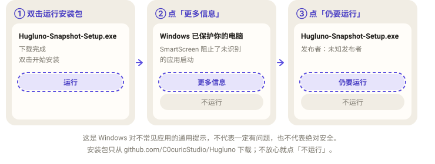
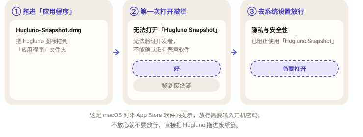

# 部署教程（简体中文）

[English](DEPLOY.en.md) · [Français](DEPLOY.fr.md) · [返回 README](../README.md)

> 在线订阅服务完整版：<https://hugluno.c0curic.top>　·　帮助中心：<https://support.c0curic.top/max/snapshot-deploy>
> **拿不准就别装**：任何一步不放心，直接停下，用「方式三：本地网页」或在线完整版，或去帮助中心 / 提 Issue 问我们。

## 先选一种方式

| 方式 | 适合 | 需要 | 系统提示 |
|---|---|---|---|
| ① Windows 安装包 `.exe` | Windows 10/11 电脑 | 无 | 会弹（SmartScreen），见[下文](#系统安全提示) |
| ② Mac 安装包 `.dmg` | macOS 11+（Intel / Apple 芯片） | 无 | 会弹（Gatekeeper），见[下文](#系统安全提示) |
| ③ 本地网页 | 想先试用、不想装软件 | Node.js 18+ | 无 |
| ④ 部署到网站 | 放在自己的服务器 / 静态托管，随处用电脑浏览器打开 | 一个域名或托管空间 | 无 |

只支持电脑端；手机 / 平板会显示「请在电脑上打开」。

## 每种方式都先做：核对文件没被调包

Releases 里每个文件都有 SHA-256（`SHA256SUMS.txt`），并带 GitHub 的构建证明（attestation）。

```bash
# Windows PowerShell
Get-FileHash .\Hugluno-Snapshot-Setup-1.1.0.exe -Algorithm SHA256
# macOS / Linux
shasum -a 256 Hugluno-Snapshot-1.1.0-universal.dmg
# 可选：用 GitHub CLI 验证它确实是本仓库的 Actions 构建出来的
gh attestation verify Hugluno-Snapshot-Setup-1.1.0.exe --repo C0curicStudio/Hugluno
```
算出来的值和 `SHA256SUMS.txt` 里的**不一致就不要安装**，删掉重下，或来仓库提 Issue。

## 方式一：Windows 安装包

1. 打开 <https://github.com/C0curicStudio/Hugluno/releases>，下载 `Hugluno-Snapshot-Setup-x.y.z.exe`（只从这里下载）。
2. 按上面的方法核对 SHA-256。
3. 双击运行 → 出现「Windows 已保护你的电脑」（见下文图示）→ 你可以**继续**或**取消**。
4. 安装向导（中 / 英 / 法）：选安装位置 → 完成。**不需要管理员权限**（按当前用户安装）。
5. 打开「Hugluno Snapshot」，到设置里填接口地址、密钥、模型。

安装器做的事（全部）：把程序文件复制到你选的目录（默认 `%LOCALAPPDATA%\Programs\Hugluno Snapshot`）、建开始菜单和桌面快捷方式、写一条卸载信息。**不装服务、不开机自启、不改系统设置、不联网。**
数据位置：`%APPDATA%\Hugluno Snapshot`（对话、窗口设置）；密钥由 Windows 数据保护（DPAPI）加密保存。
卸载：设置 → 应用 → Hugluno Snapshot → 卸载；想彻底删除数据，再删上面的数据文件夹（或先在软件里「设置 → 清除本机全部数据」）。

## 方式二：Mac 安装包

1. 下载 `Hugluno-Snapshot-x.y.z-universal.dmg`，用 `shasum -a 256` 核对。
2. 双击打开 dmg，把图标拖进「应用程序」。
3. 第一次打开会被拦（见下文图示）：打开「系统设置 → 隐私与安全性」，在底部「已阻止使用 Hugluno Snapshot」旁点**仍要打开**，输入开机密码。
4. 仍打不开：终端运行 `xattr -dr com.apple.quarantine "/Applications/Hugluno Snapshot.app"`（只是去掉下载隔离标记），再打开。
5. 数据位置：`~/Library/Application Support/Hugluno Snapshot`；密钥存在「钥匙串」。
卸载：把应用拖进废纸篓；想删数据就删上面的文件夹。

## 系统安全提示

**为什么会弹：** Windows 的 SmartScreen、macOS 的 Gatekeeper 会拦「没有商业开发者签名、下载量少」的软件。快照版是开源项目，安装包**没有购买商业代码签名**（Windows）、**也没有经过 Apple 公证**（Mac），所以系统一定会提示。**提示不说明软件有问题，也不保证软件安全**——请你用上面的 SHA-256 和源码来判断。

### Windows：「Windows 已保护你的电脑」


继续：点「更多信息」→「仍要运行」。**取消：点「不运行」**，什么都不会被安装。

### macOS：「无法打开，因为无法验证开发者」


继续：系统设置 → 隐私与安全性 → 仍要打开。**取消：点「好」或「移到废纸篓」。**

### 我们的安全策略（装之前请看）
- 安装包只由本仓库的 GitHub Actions 构建并发布在 Releases，附 SHA-256 与构建证明；**不要使用来自其他网站、群文件、网盘的安装包。**
- 程序**没有账号、没有自动更新、没有统计**，也不会在后台联网。升级要你自己下载新版本并核对。
- 桌面版：窗口运行在沙盒里，页面拿不到 Node / 文件系统；权限请求（摄像头、麦克风、定位…）一律拒绝；所有网络请求经总闸，只放行你填的模型接口。
- 我们**不会**要求你关闭杀毒软件、不会要求管理员权限、不会让你在终端里粘贴来历不明的命令（上面 `xattr` 那一条只去掉隔离标记，你也可以跳过它直接用方式三）。
- 任何一步不放心：**取消**，改用方式三 / 在线完整版；或看帮助中心的 [安装软件时的安全提示](https://support.c0curic.top/max/settings/install-safety)；仍有疑问就提 Issue，我们来解释。
- 发现漏洞：见 [SECURITY.md](../SECURITY.md)。

## 方式三：本地网页（最简单，也最容易审查）


```bash
git clone https://github.com/C0curicStudio/Hugluno.git && cd Hugluno
node tools/audit.mjs        # 可选：先审查
node tools/serve.mjs        # → http://127.0.0.1:8080/
```
`serve.mjs` 零依赖、只读、默认只监听 `127.0.0.1`。用 `--port 9000` 换端口。数据存在这个浏览器里；换浏览器就是新的一份。

## 方式四：部署到你自己的网站


### 1. 取得网站部署包
- 直接下载 Releases 里的 `hugluno-snapshot-web-x.y.z.zip`，解压得到 `hugluno-snapshot-web/`；或
- 自己打包：`node tools/pack-web.mjs`（输出 `dist/…zip` 和 SHA-256；同一份源码打出的包逐字节相同，可以复现核对）。

### 2.（推荐）把 CSP 收紧到只剩你的模型接口
```bash
node tools/lock-csp.mjs --api https://api.deepseek.com --out dist/site
```
之后浏览器会拒绝这个页面向任何别的地址发请求。（「接口调试」卡要请求别的地址，就不要收紧；局域网里的 Ollama 也用 `--api http://192.168.1.20:11434` 写进来。）

### 3. 选一个地方放
| 托管 | 做法 |
|---|---|
| **Cloudflare Pages / Netlify** | 控制台「上传目录」选 `hugluno-snapshot-web`（或 `dist/site`）；再把 `deploy/_headers` 放到目录根。 |
| **GitHub Pages** | Settings → Pages → Source 选 *GitHub Actions*；Actions 里手动运行 *Deploy web to GitHub Pages*。 |
| **自己的服务器（nginx）** | 解压到 `/var/www/hugluno`，用 `deploy/nginx.conf`（改域名与证书路径），`nginx -t && systemctl reload nginx`。 |
| **Caddy**（自动 https） | 解压到 `/srv/hugluno`，用 `deploy/Caddyfile`（改域名），`caddy run`。 |
| **Docker** | `docker build -f deploy/Dockerfile -t hugluno-snapshot .` → `docker run --rm -p 127.0.0.1:8080:8080 hugluno-snapshot` |

### 4. 上线前检查清单
- [ ] 用 **https**（或 localhost）访问；
- [ ] 响应头里有 `X-Content-Type-Options`、`Referrer-Policy: no-referrer`（`deploy/` 里的配置已带）；
- [ ] `/fonts/*` 带 `Access-Control-Allow-Origin: *`（学习台里要用自有字体）；
- [ ] 想只给自己用：加 HTTP 基本认证（`deploy/nginx.conf` 里有注释好的两行）；
- [ ] 服务器上**不要放任何密钥**：这个站没有后端，密钥由每个访问者填在自己的浏览器里。

### 网站版要知道的
- 密钥存在访问者浏览器的 localStorage（可在设置里用口令加密）；换浏览器要重填。
- 浏览器直连模型接口要求服务商允许跨域（CORS）。不允许的（报「跨域 CORS」）请改用桌面版——桌面版由主进程发请求，没有这个限制。
- 本机 Ollama：启动前设环境变量 `OLLAMA_ORIGINS=*`（或你的网站地址）。

## 升级与回退
下载新版本 → 核对 SHA-256 → 覆盖安装（Windows / Mac）或替换网站文件。对话数据不会丢（存在用户数据目录 / 浏览器里）。想回退就装旧版本。

## 常见问题
- **打不开 / 被拦截？** 先看上面「系统安全提示」；仍不行用方式三。
- **「测试连接」失败？** 检查接口地址是否以 `/v1` 等结尾（各家不同）、密钥是否有余额；网页版看是否被 CORS 拦。
- **想确认它没偷偷联网？** 设置 → 网络记录；或 `node tools/audit.mjs`；或用系统防火墙 / 抓包工具自己验证。
- **想要账号同步、云端运行？** 那是 [在线完整版](https://hugluno.c0curic.top) 的功能，快照版不含。
